# ClearVoice E-Invoicing Compliance Gateway

[](LICENSE)


ClearVoice is an institutional-grade B2B e-invoicing compliance gateway designed to bridge Enterprise Resource Planning (ERP) systems with national tax clearance authorities, specifically tailored for the Jordanian e-invoicing compliance model.

---

## Visual Preview & Interface (Light & Dark Mode)

### Executive Dashboard & Compliance Analytics
| Light Mode | Dark Mode |
| :---: | :---: |
| 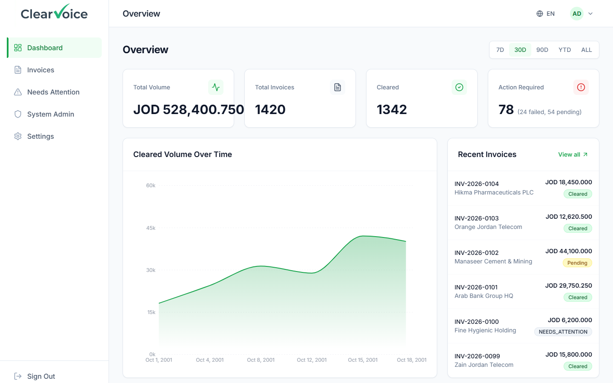 | 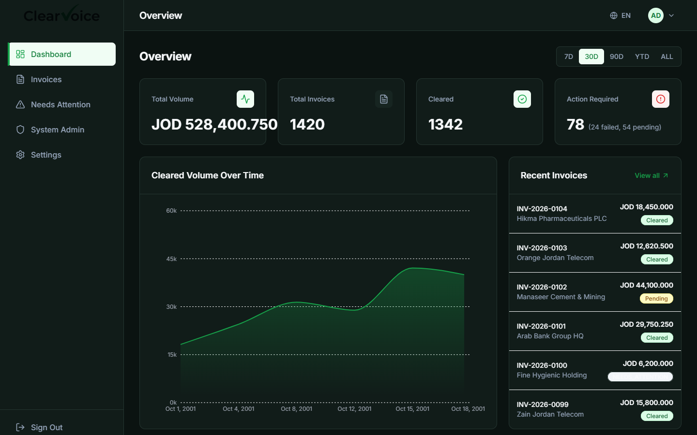 |

### Invoice Management & Tax Clearance Ledger
| Light Mode | Dark Mode |
| :---: | :---: |
| 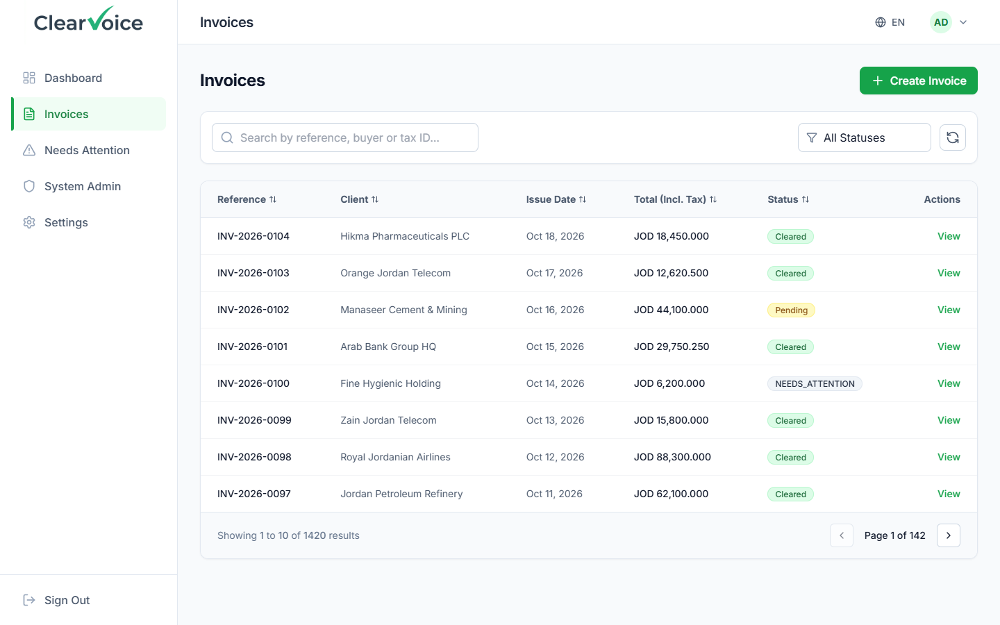 | 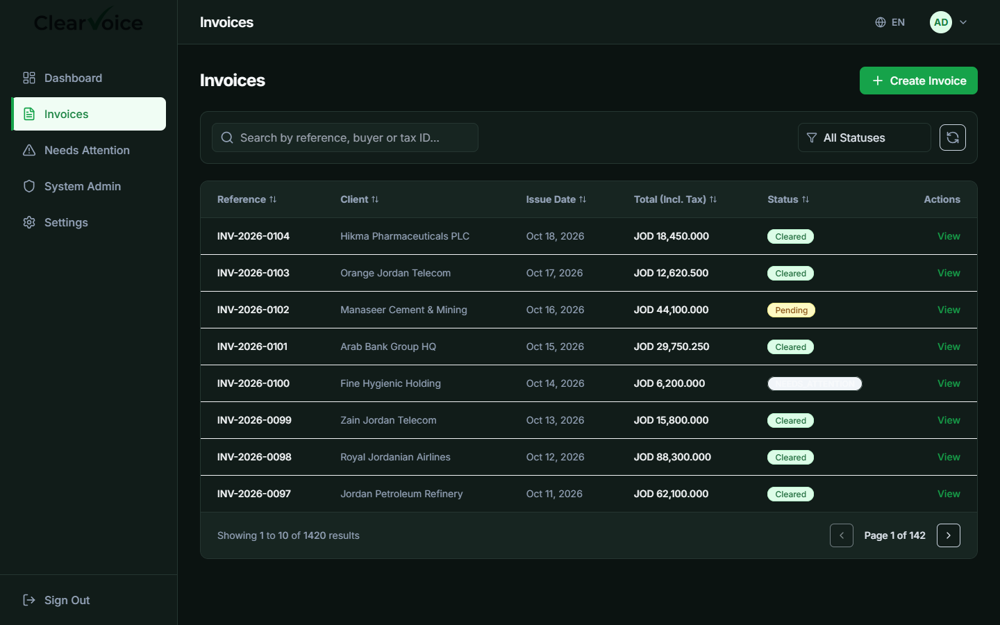 |

### Interactive Tax Invoice Builder
| Light Mode | Dark Mode |
| :---: | :---: |
| 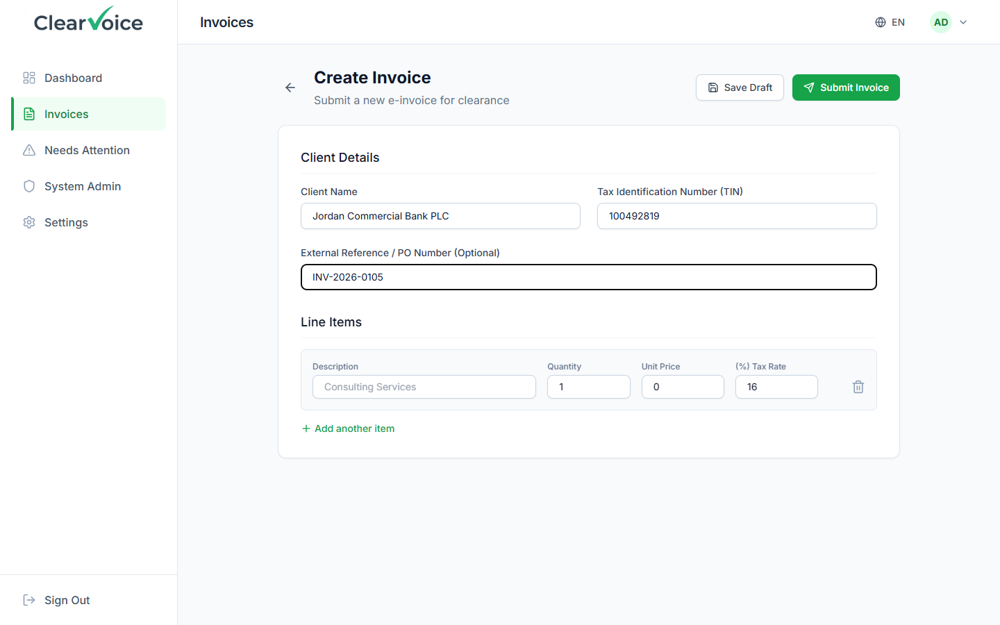 | 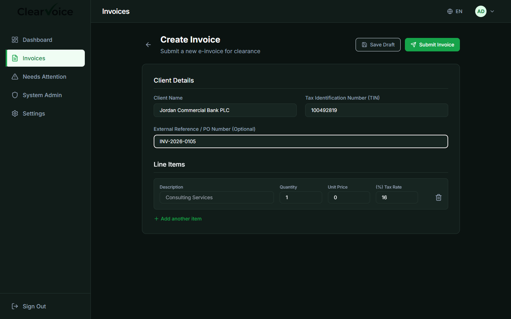 |

### Exception Queue & Needs Attention
| Light Mode | Dark Mode |
| :---: | :---: |
| 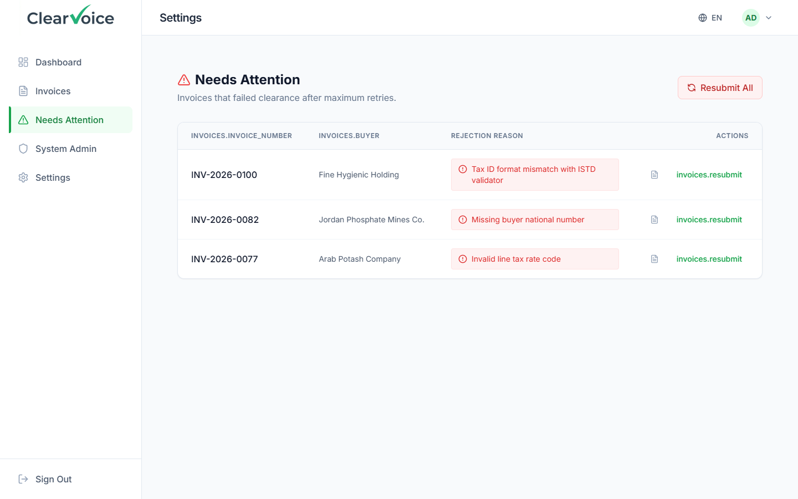 | 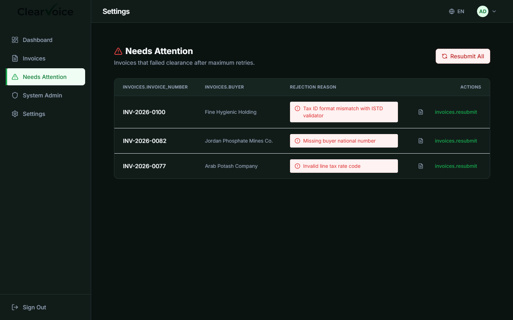 |

### Settings & Institutional Configuration
| Light Mode | Dark Mode |
| :---: | :---: |
| 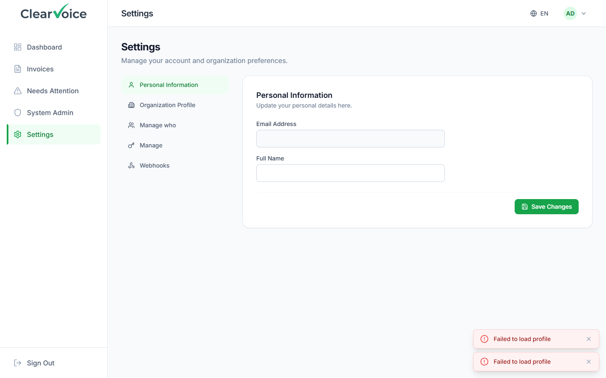 | 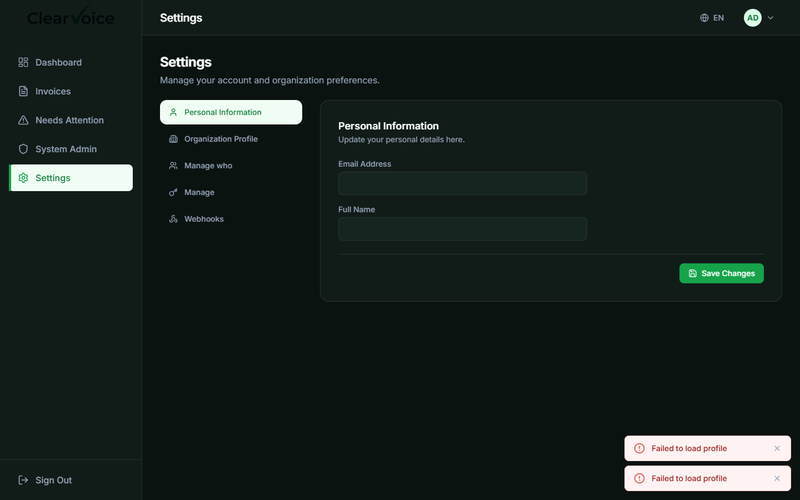 |

### Public Portal & Authentication
| Landing Portal (Light) | Enterprise Sign In (Dark) |
| :---: | :---: |
| 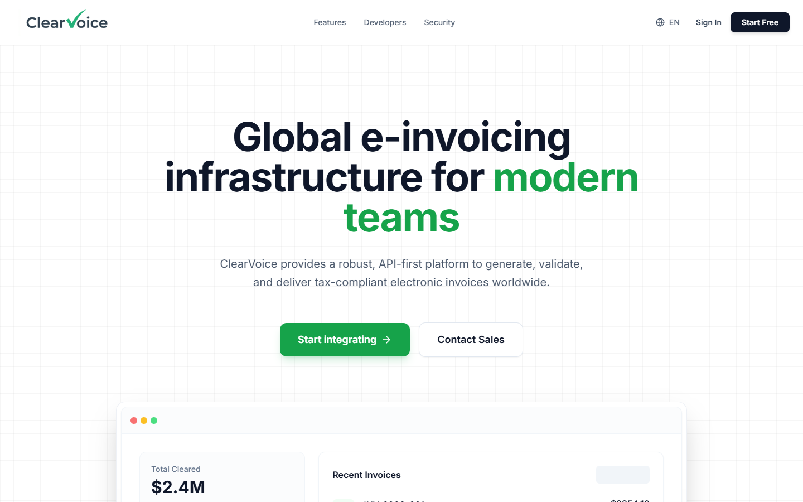 | 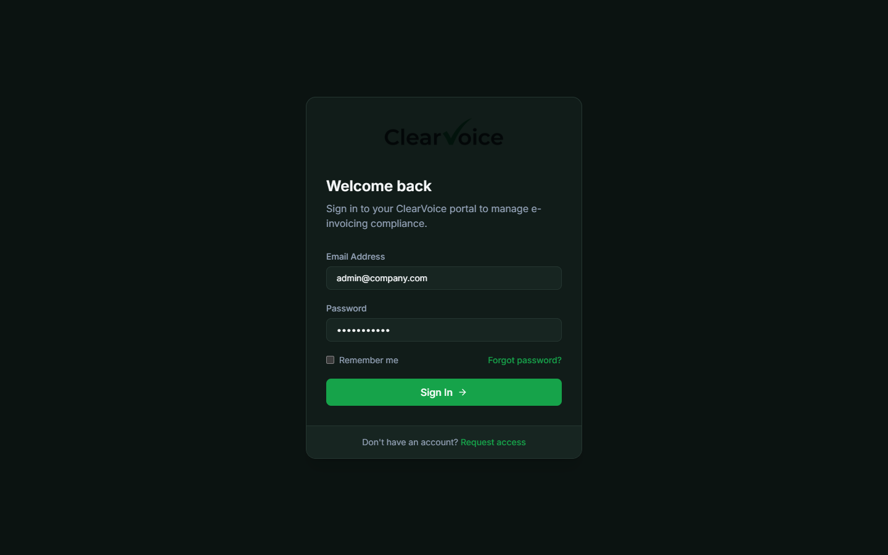 |

---

## Architecture & Clean Architecture Principles

The system follows a strict **Clean Architecture** approach with **CQRS** (Command Query Responsibility Segregation) principles to ensure high maintainability, testability, and decoupled business logic:

1. **`ClearVoice.Domain`**: Core enterprise models and entities (`Tenant`, `Invoice`, `User`, `OutboxMessage`, `WebhookSubscription`), along with domain exceptions. Has zero external dependencies.
2. **`ClearVoice.Application`**: Use-case orchestration using **MediatR** for CQRS command/query segregation. Request validation is handled using **FluentValidation** pipeline behaviors before handlers execute.
3. **`ClearVoice.Infrastructure`**: Persistence and external interfaces:
   - **PostgreSQL & EF Core**: Relational persistence and schema migrations.
   - **Multi-Tenant Data Isolation**: Automated EF Core Global Query Filters (`CurrentTenantId`), ensuring tenant data isolation at the ORM query level.
   - **Clearance Service**: Contract interface `IClearanceClient` (currently implemented with `MockClearanceClient` for local simulation).
4. **`ClearVoice.Api`**: RESTful presentation layer (ASP.NET Core 8 Web API) using JWT bearer tokens and machine-to-machine API keys.
5. **`ClearVoice.Workers`**: Background service that polls the outbox table and submits pending invoices to the clearance client.
6. **`frontend/`**: Multilingual Single Page Application (React 19 + Vite + TypeScript + Tailwind CSS).

---

## Key Engineering Decisions

### 1. Multi-Tenancy & Data Isolation
Security in multi-tenant SaaS is paramount. Data isolation is enforced via **EF Core Global Query Filters**. An injected `ITenantProvider` extracts the tenant ID from authenticated JWT claims or API key headers, appending `WHERE TenantId = @id` to every query automatically to eliminate tenant leakage.

### 2. Password Security (Argon2id)
User password hashing uses **Argon2id** (via `Konscious.Security.Cryptography`), the OWASP-recommended algorithm offering superior resistance to GPU cracking and side-channel attacks compared to legacy PBKDF2 or standard BCrypt.

### 3. API Key Authentication for Machine-to-Machine (ERP) Integration
While web users authenticate via short-lived JWT tokens, ERP integrations utilize long-lived API keys. The system returns the plain-text key only once upon generation and persists an irreversible **SHA-256 hash** in the database, ensuring keys cannot be retrieved if the database is read.

### 4. Transactional Outbox Pattern & Background Workers
Submitting invoices to external services over HTTP introduces network failure risks. `SubmitInvoiceCommandHandler` persists the `Invoice` and an associated `OutboxMessage` in a single atomic database transaction, so an invoice is never accepted without a matching outbox record. The background worker (`ClearVoice.Workers`) polls every 5 seconds for pending messages (up to 20 per batch) and submits them to the clearance client.

### 5. HMAC-Signed Webhook Notifications
When an invoice status transitions (e.g. Cleared or Rejected by the national clearance service), the system dispatches an HTTP POST webhook containing an HMAC-SHA256 signature header (`X-ClearVoice-Signature`) so subscribers can verify message authenticity.

### 6. Modern Multilingual Frontend
The web portal supports Arabic (RTL) and English (LTR) using `i18next`:
- **Styling**: Tailwind CSS with custom design tokens for institutional compliance software.
- **Interactions**: Framer Motion transitions and toasts.
- **Component Design**: Strict TypeScript contracts and reusable form components.

---

## Getting Started

### Prerequisites
- [.NET 8 SDK](https://dotnet.microsoft.com/download/dotnet/8.0)
- [Node.js](https://nodejs.org/) (v18 or v20 LTS)
- [Docker & Docker Compose](https://www.docker.com/)

---

### Option A: Run via Docker Compose

> **Note:** The compose file and Dockerfiles for the API and frontend were added recently and have not yet been verified end-to-end on a clean machine. Option B is the tested path. The background worker is not included in compose; run it with `dotnet run --project src/ClearVoice.Workers`.

Run the database, API, and frontend in containers:

```bash
docker compose up --build
```

- **Frontend**: http://localhost:5173
- **Backend API**: http://localhost:5242
- **Swagger Documentation**: http://localhost:5242/swagger

---

### Option B: Local Development Workflow

#### 1. Start the Database
```bash
docker compose up -d db
```

#### 2. Run Database Migrations
```bash
dotnet ef database update --project src/ClearVoice.Infrastructure --startup-project src/ClearVoice.Api
```

#### 3. Start Backend Services
In separate terminal windows:
```bash
# Start API
dotnet run --project src/ClearVoice.Api

# Start Background Worker
dotnet run --project src/ClearVoice.Workers
```

#### 4. Start Frontend
```bash
cd frontend
npm install
npm run dev
```

> **Automated Dev Script:**  
> - On Windows (PowerShell): `.\start-dev.ps1`  
> - On Linux / macOS (Bash): `./start-dev.sh`

---

## Seeded Demo Credentials

When the database initializes, the application seeds the following demo accounts for testing:

| Role | Email | Password | Access Scope |
| :--- | :--- | :--- | :--- |
| **Tenant Admin** | `admin@company.com` | `password123` | Dashboard, Invoices, Webhooks, API Keys |
| **System Operator** | `system@clearvoice.com` | `admin123` | Multi-tenant administration portal |

---

## Running Automated Tests

To run the unit and integration test suite:

```bash
dotnet test tests/ClearVoice.Api.Tests/ClearVoice.Api.Tests.csproj
```

To run frontend production build checks:

```bash
cd frontend
npm run build
```

---

## Limitations / Not Yet Implemented

1. **Simulated Clearance Endpoint**: Clearance is implemented with `MockClearanceClient`; no real government endpoint is integrated. Jordan's national e-invoicing system is **JoFotara**, operated by the Income and Sales Tax Department (ISTD) ([portal.jofotara.gov.jo](https://portal.jofotara.gov.jo/)). Connecting to it requires a registered taxpayer account and ISTD-issued API credentials, which this project does not have.
2. **Outbox Retry & Locking**: The worker has no retry/backoff: a failed clearance call marks the invoice `REJECTED` and the outbox message `processed`. It also takes no row lock, so running more than one worker instance could process the same message twice. Exponential backoff using the existing `NextAttemptAt` column and `SELECT ... FOR UPDATE SKIP LOCKED` would address both.
3. **Real Email/SMS Dispatch**: User onboarding and password reset flows output verification tokens and log notifications internally; production SMTP / SMS gateway integration is not configured.
